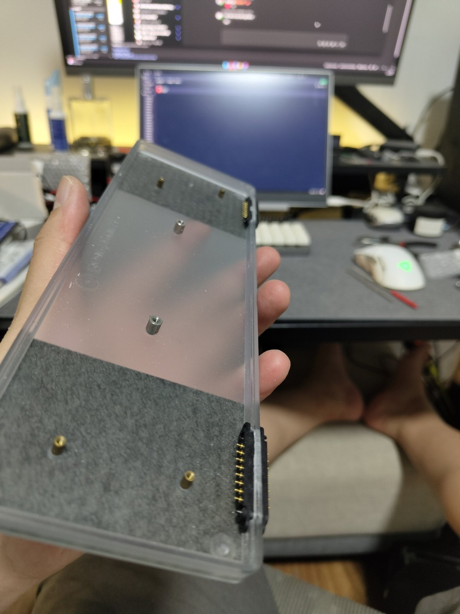
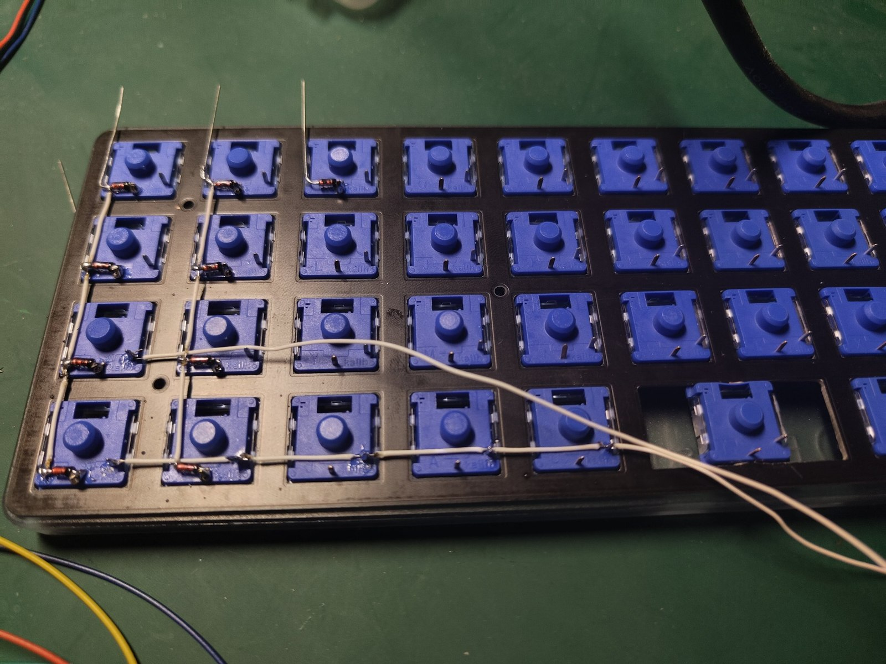
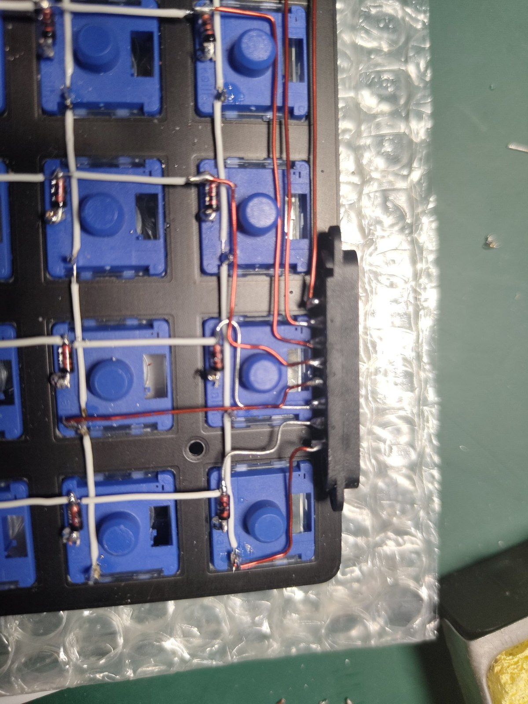
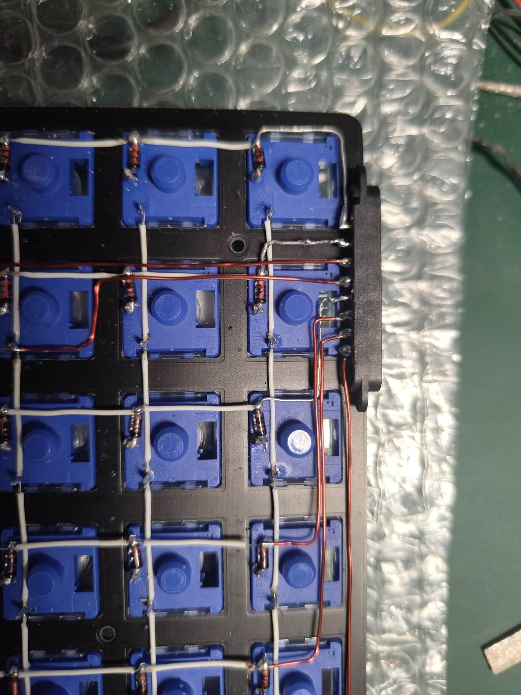
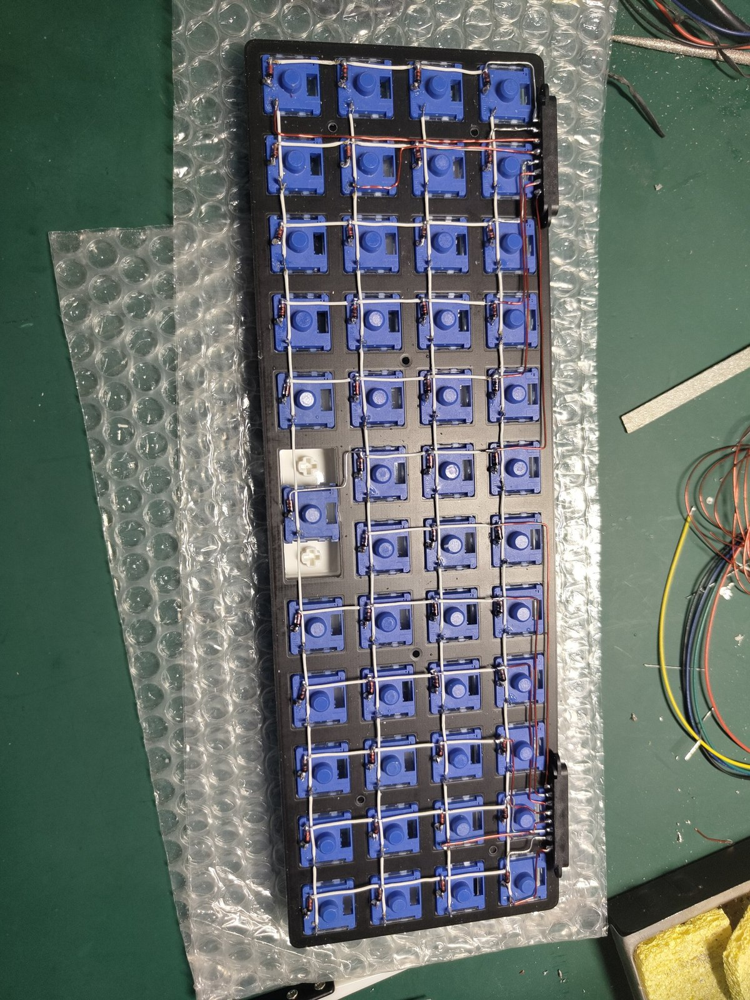

[Part 1](/posts/my-first-zmk-planck-part-1/) ended on an idea: the keyboard holds nothing but the matrix, and the controller and battery live on a detachable bar along the rear edge.

That sentence hides all the work. A passive matrix is useless on its own — it only becomes a keyboard when sixteen signals reach a controller. So the bar is not a mounting bracket. It is a connector problem wearing a bar costume, and it is the part of this build I spent the longest arguing with myself about.

## Sixteen, and not one more

The constraint from Part 1, restated, because everything here follows from it:

4 rows + 12 columns = 16 signals. The controller has exactly 16 usable GPIO. No spares, no ground return across the joint, no detect pin, no I2C.

And the joint comes apart. That is the entire point of the bar — swap controllers, pull it off for travel, replace a dead nRF52840 without desoldering a matrix. So those sixteen have to make and break contact repeatedly, by hand, and be right every time.

A matrix is unforgiving about this in a specific way. Row and column lines are high-impedance with internal pull-ups, so a little contact *resistance* costs nothing — you are not pushing current through them. What kills you is an intermittent *open*. One pin that loses contact under flex gives you a column that dies when you press on the case and returns when you let go. That is the worst bug class on a handwire, because it looks exactly like a bad solder joint somewhere in a matrix you built by hand — and you will go looking there first.

## No power across the joint

One decision was easy, and I want to flag it because it is the one I would keep in any future version.

**Only matrix signals cross the connector. No battery, no VCC, no ground rail.** The battery lives on the bar, next to the controller it powers. Nothing on the keyboard side is energised at all.

If power crossed that joint, every reseat would be a chance to short a cell through a pogo pin that landed half-on, or to brown out the controller mid-write. Matrix lines have no such failure mode — a bad contact there is a missing keypress, not a thermal event. Keeping the passive side genuinely passive turns the worst case from "damage" into "annoying".

**Decision: signals only.**

## The options, and the advice I ignored

Four ways to get sixteen lines across a removable joint.

**Bonded.** Run sixteen wires straight from the matrix to the bar, no connector at all. The most reliable thing on this list, and it throws away the entire reason the bar exists. If the controller dies — and spoiler for Part 4, it did — you are desoldering sixteen wires. Out.

**One 2x8 pin header in the centre.** On paper, the best option here. Standard part, keyed, self-aligning, real retention force, hundreds of mating cycles. One connector means one alignment datum, so there is no stack-up to get wrong. The only technical cost is that all sixteen wires converge on a single point mid-case, which on a handwire is a bundle you will want to sleeve.

It lost for a reason that is not technical at all. The case already has an opening at the right rear — it is where the controller's port was always meant to come out, and it is where mine comes out now. Putting the connector in the centre means cutting a *second* opening into the middle of the rear edge while the original sits there doing nothing.

Two holes in a rear edge, one of them pointless, in a case I was given. I could not do it. There is no engineering in that sentence and I will not dress it up as any — the centre header was the better connector and I rejected it over the look of a piece of acrylic.

Look at the plate and you can see why that mattered more than it should. The acrylic is frosted but translucent — there is no back side to hide anything on. Every cut, every brass insert, every standoff reads straight through the material from either direction. On an opaque case a spare hole is something you see only when you turn it over. On this one it is permanent furniture.

The other thing in that photo was deliberate, and it is the part of the design I had the clearest picture of before I built any of it.

Both connectors sit at the far ends of the edge, hard against the corners, where the side walls meet the plate and the acrylic is at its stiffest. That is not where they landed. That is where I put them. A snap-on bar lives or dies on the panel it snaps to holding still, and the centre of a 250 mm acrylic span is the one place guaranteed not to — maximum deflection, with the whole plate free to flex either side of it. Mount your one critical alignment feature there and every press on the keyboard works against it.

So the "two connectors means two chances to misalign" objection cuts both ways. Two datums are worse than one in principle. But mine sit where the case barely moves, and the one-datum version would sit where it moves most.

I should be honest about what "planned" means here, though. There is no sketch of this. No drawing, no notes, no calculation — the whole mechanism lived in my head, the way these things always do for me, and the first time any of it existed outside my skull was when I started cutting. Which is a lovely way to work, right up until something does not fit and there is no document to check your intent against. That bill comes due in Part 5.

**Two 1x8 pin headers at the ends.** Shorter wire runs, keyed, retained — but now two connectors have to mate simultaneously, and you have to push them together.

**Two 1x8 magnetic pogo connectors at the ends.** Quick-release, no insertion force, satisfying. Also the riskiest option on the list.

I got told, in plain terms, not to do the last one. Three objections, all technically correct. I want to go through them one at a time, because having an answer to an objection is not the same as the objection being wrong.

**"Tolerance stack-up."** Two connectors roughly 250 mm apart both have to seat at once, on a hand-built bar, against a laser-cut acrylic case that bows. Magnets self-align over maybe ±0.3 mm. Across that span you can easily end up with one connector fully home and the other with two or three pins marginal.

All true. It is also, precisely, the thing I am here to do. The whole project is a handwire — I am already betting the build on whether I can place things accurately by hand. A connector pair that punishes sloppy alignment is not an obstacle to that, it *is* that, with a pass/fail light on it. If I cannot land two connectors on one edge, better to find out on a keyboard I built for fun than to assume I can.

**"No wipe, no retention."** Pogo tips oxidise and collect pocket lint, and a magnet-held joint has no wiping action to clean the contact and nothing holding it but the magnet.

Also true, and also how every smartwatch I own charges. I have a few. None of them lasted five years on their original contacts — but they live on a wrist, outdoors, through sweat and rain and whatever a day does to them. This one sits on a desk mat, indoors, in a room with a roof. Same part, a fraction of the abuse. And when the contacts do eventually go, pogo connectors are a consumable: unsolder, replace, carry on.

**"Magnets next to a radio."** The controller's chip antenna is at the USB end. Neodymium and steel pole pieces along the rear edge will detune it; keep 10–15 mm clear or accept worse BLE range.

True again, and here I genuinely do not care. Worse than what? The link is desk mat to PC — call it half a metre. In dongle mode it is keyboard to a dongle plugged into the same machine, closer still. BLE is specified for tens of metres. If detuning costs me half my range I am still an order of magnitude inside what this link needs. That is margin I am happy to spend on a connector I wanted.

So: not a reckless decision, but not a defensible one either. Every objection survives my answer to it. What my answers really say is that the costs land somewhere I do not mind paying — a desk keyboard, a replaceable part, a short link, and a tolerance problem I actively wanted to attempt.

**Decision: two 1x8 magnetic pogo connectors, 2.54 mm pitch, one at each end of the rear edge.**

If you are building this to go in a bag, or for someone else to rely on, use the pin header. Those three objections do not go away just because mine happens to sit still.

## The pin map, and the two pins I would not touch

Sixteen signals, two connectors, eight each. That split is not arbitrary — each connector wants to land on the controller pad rail nearest it, so the obvious mapping is 8 to the left rail and 8 to the right.

The obvious mapping is wrong, because of which pins the right rail actually offers.

On the nRF52840, two of those pads are the NFC antenna pins. They work as GPIO, but only with a build-time flag that takes them away from the NFC peripheral, and they carry a reputation for odd behaviour. On a board where a flaky column was already going to be hard to localise, I was not spending credibility on two pins with an asterisk next to them.

So: **10 pins on the left rail, 6 on the right**, skipping the NFC pads entirely. The price is two wires that cross the width of the bar to reach the far rail. Two crossings is cheap. Debugging an NFC pin is not.

| Connector | Carries | Lands on |
| --- | --- | --- |
| A (left end) | R1, C1, C2, R2, C3, C4, C5, C6 | D1, D0, D2, D3, D4, D5, D6, D7 — left rail |
| B (right end) | C7, C8, C9, C10, R3, R4 | right rail |
| B (left end) | C11, C12 | D9, D8 — crossing to the left rail |

## Wiring it

With the connectors mounted and the map settled, the matrix is just work. Diodes at every switch, columns and rows in white, and then sixteen runs in red out to the two connector blocks.

The red wires in these photos are the subject of this entire post. Everything white is internal — it only has to reach the next switch. The red ones are the sixteen that leave, and every one of them ends at a pogo pin that will be pulled apart and pushed back together for as long as this keyboard exists.

## Sealed

That is the end of Part 2, and it is a strange place to stop, because look at what is not in that photo.

There is no controller. Not an empty socket waiting for one — nothing. The case is modified, the connectors are mounted, all 48 keys are wired and verified, and the board in front of me is complete in the only sense that matters: nothing else needs to happen inside it, ever.

And I had still not chosen a controller.

That was not procrastination. It was the whole point, and I only realised how much I meant it later. The matrix is not committed to a *board*. It is committed to a *pinout convention* — the pro micro pad layout, which half the hobby builds against and which ZMK addresses through aliases rather than hardware names. Any board that speaks that layout will do. I did not decide what the controller is. I decided that it would not matter.

Which is a nice thing to say in a blog post, and an even better thing to have actually done, because in Part 4 I throw two controllers in the bin and the matrix never knows.

Next, though, is the firmware: a shield named `planck_choc`, a repo that holds two keyboards at once, and a Docker container that builds Zephyr on a Windows machine.

---

*Part 3 — the ZMK shield, the module-style repo layout, and getting a local build out of a container.*
