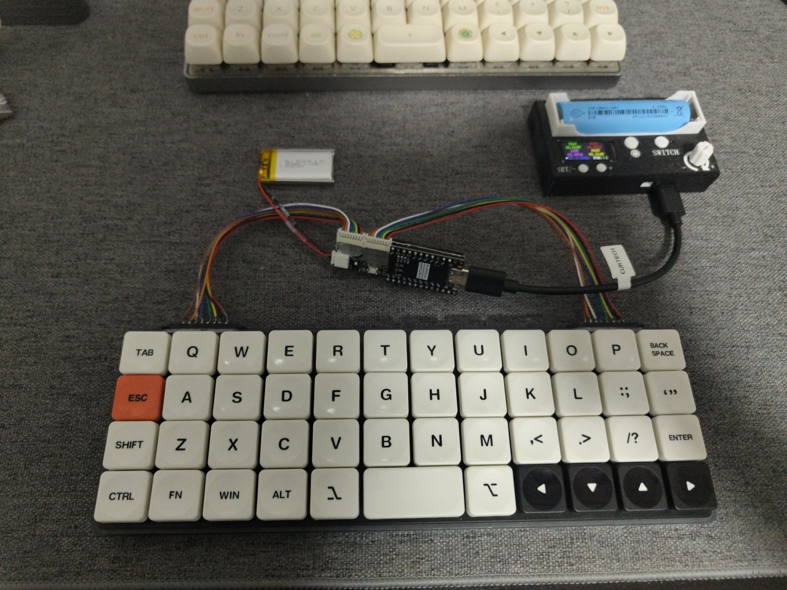

I have been a Planck user for years. Two of them sit on my desk right now. Both wired.

That is the whole problem, and it took a long time to admit it was a problem worth solving myself.

## Waiting for a revision that was never going to be wireless

For years I kept waiting for the next revision to be the one.

Rev6 came — a full hardware rework, STM32 Cortex-M4, encoders, the works. USB cable. Then rev7 arrived in 2023 with north- and south-facing backlight, a USB port moved lower so it breaks less, eight encoder slots, new plate and case options. Also a USB cable.

Every generation got better at being the keyboard it already was. None of them got a radio.

At some point waiting stops being waiting and starts being a decision you are quietly refusing to make. There was no wireless Planck coming. The only one that was ever going to exist was one I built.

I was not starting from nothing, either. I had already been through ZMK on Corne builds — shields, keymaps, the build container, the whole loop of flashing something and finding out which pin you got wrong. Wireless firmware was no longer the scary part.

That changes the math completely. If the firmware side is known, the only thing between me and a wireless Planck is hardware I would have to make myself.

## The parts that were already here

The project did not start with an order. It started with a shelf.

<!-- Drop a photo at src/assets/planck/parts.jpg and uncomment:

-->

A set of Choc v2 switches had been sitting in storage for a few years. So had a Boardsource Technik_0 acrylic case — [SHOUTOUT: friend who gave me the case, fill in]. Neither had been bought for this. They were leftovers from intentions that never became builds, the kind of parts you move from one drawer to another and feel vaguely guilty about every time.

Put those two next to a problem that needs solving and the project assembles itself. Choc v2, Technik_0, 4x12, wireless, mine.

## Why handwire

Here is where a build log usually tells you the author could not design a PCB.

I can design a PCB. I did it at university; the skill is in there somewhere under a few years of dust. That is not the obstacle. The obstacle is everything that happens *after* you design one.

I have been through that cycle already, more than once. You design a board. You send it offshore, because the quantity a manufacturer wants is never the one board you actually need. You wait. It arrives. You find the mistake. You do it again. And then the POCs sit on a shelf — version after version of a thing that was almost right — until years later you finally throw the whole stack out.

I did not want another shelf like that. Not for a keyboard I wanted to be *using*.

And underneath the reasoning there is a simpler reason: handwiring is fun. Magnet wire, diodes, a soldering iron, and a matrix you build one joint at a time. It is the part of this hobby where you are actually making something with your hands, instead of filling a cart and refreshing a tracking page. No PCB means no footprint to design around, no revision to wait for, no minimum order quantity deciding what you are allowed to build.

Handwiring also hands back something the stock board took: the 1.6 mm PCB and its hotswap sockets ate most of the interior height of an already thin case. Remove them and that space is mine to spend.

Which brings us to the number this entire project turns on.

## Everything is decided by one measurement

Before ordering a single part, I dropped a switch into the plate, seated the plate in the case, and measured floor to plate underside.

About 5 mm.

<!-- Drop a photo at src/assets/planck/measure.jpg and uncomment:

-->

That is the budget. Everything — controller, battery, switch, wiring — has to live inside 5 mm or live outside the case. There is no third option and no amount of clever layout gets around it.

Then the Choc v2 made it worse. The housing has a large centre boss that protrudes below the plate at full key travel ([switch dimensions on Deskthority](https://deskthority.net/wiki/Kailh_PG1353_series)). So it is not even a flat 5 mm: under the switch field, the usable space is whatever is left after 48 switches finish moving. A LiPo pouch under the keys was dead on arrival.

<!-- Drop a photo at src/assets/planck/choc-boss.jpg and uncomment:

-->

**Controller.** The requirement list was short and unforgiving: Zephyr support, 16 GPIO for a 4x12 matrix, and BLE. Sixteen pins for sixteen matrix lines — no spares, no encoder, no RGB. I looked past the obvious Pro Micro and XIAO footprints at ItsyBitsy, Feather, bare nRF52840 modules. Bare modules are the right answer for a thin stack and the wrong answer for a handwire, because hand-soldering castellated pads plus your own USB, LDO and charger is not a fun evening. A nice!nano-class board with a UF2 bootloader, a battery charger and a voltage divider ZMK already reads is the sane pick. (Part 4 is about what happens when the board you buy is only *claiming* to be that.)

**Battery.** When the case is 5 mm, capacity stops being the spec you shop on. Thickness is. A 3 mm cell gets you roughly 110–150 mAh; 4 mm gets you 150–200 mAh. Then remember a JST connector is about 4 mm tall all by itself, which means soldering straight to the pads or giving up the entire budget to a plug.

**Power switch.** Skipped. The case has no cutout for one, and ZMK deep sleep idles in the microamps — months of standby. A switch only earns its place for long storage, and it would cost millimetres I did not have.

## Where that leaves the design

Add it up and the conclusion writes itself: nothing that needs volume can live under the switch field. Not the battery, not the controller.

So the keyboard stops being a keyboard and becomes a matrix. 4 rows, 12 columns, 48 keys, diodes, magnet wire. No controller. No battery. No power anywhere inside the case.

The brain and the power have to live somewhere else, mounted somewhere else, and reach the matrix across a joint that does not exist yet.

Designing that joint is Part 2, and it is the most interesting problem in the build.

---

*Next: the detachable controller bar — getting 16 matrix lines out of a passive case, and the connector decision I argued myself into.*
